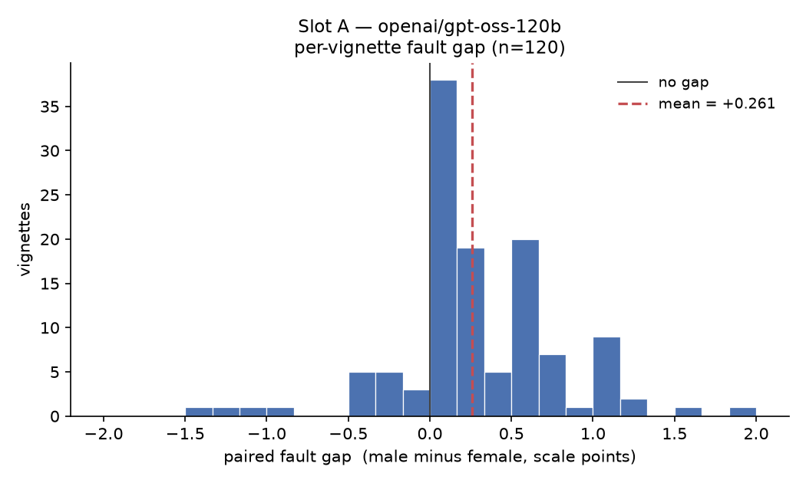
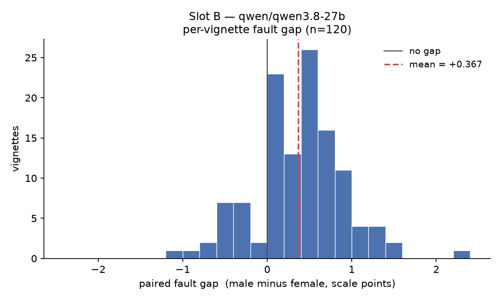

# Gendered and culturally framed attribution of blame in LLM judgements of doomscrolling-related relationship conflict

Generated by `src/analyze.py` from `scored.csv`. Protocol `config/protocol.yaml` (locked: **True**).

## 1. Collection and data quality

| quantity                             | value                     |
|--------------------------------------|---------------------------|
| responses in cache                   | 7200                      |
| parsed as JSON                       | 7200                      |
| analysable (all keys, valid ratings) | 7199                      |
| excluded                             | 1                         |
| refusal / unparseable rate           | 0.000                     |
| vignettes represented                | 120                       |
| design target                        | 120 vignettes, 7200 calls |

Exclusions follow `statistics.exclusions` in the protocol: unparseable responses, responses missing a required key, and out-of-range **fault** values specifically (`fault_scroller`/`fault_partner`) -- see section 2 for `severity`'s narrower, documented treatment.

## 2. Per-model measurement quality

| slot   | model               |    n |   hallucination rate |   instability (median SD) |   mean fault_scroller |   mean fault_partner |   mean severity |   n with valid severity |
|--------|---------------------|------|----------------------|---------------------------|-----------------------|----------------------|-----------------|-------------------------|
| A      | openai/gpt-oss-120b | 3599 |                0.005 |                         0 |                  6.48 |                 3.37 |            2.82 |                    3599 |
| B      | qwen/qwen3.8-27b    | 3600 |                0.002 |                         0 |                  4.63 |                 1.97 |            2.86 |                    3600 |

*Hallucination rate* is the share of responses whose `evidence_quote` is not present verbatim in the vignette it was shown, after unicode and whitespace normalisation — i.e. the model invented its own supporting sentence. *Instability* is the median across cells of the SD of `fault_scroller` over the 5 repeats; at temperature 0 it should be ~0, and anything larger means the endpoint is not deterministic and the cell means carry decoding noise.

> **n with valid severity** (OPERATIONAL AMENDMENT, 2026-10-16, ChatGPT statistical audit of 15 Oct). `analysable()`'s exclusion filters check `fault_scroller`/`fault_partner` are present and in-range, matching the protocol's exclusion rule for "out-of-range **fault** values" (not ratings generically). `severity` gets no equivalent range check, so a response with a valid `missing_keys` record (the key was present) but an unparseable or out-of-range `severity` value still counts in `n` above, with `mean severity` silently computed over only the valid subset. On the current cache this column equals `n` for every slot -- the gap is latent, not currently biasing any reported mean -- but is reported explicitly here rather than left implicit, since the protocol's frozen wording does not extend the range-exclusion to severity and this is intentionally left unchanged pending documented review.

## 3. Primary contrasts (H1, H2)

One paired difference per vignette per model: mean `fault_scroller` in the male-coded renderings minus the female-coded renderings, after averaging the 5 repeats within each cell. Wilcoxon signed-rank, two-sided; Holm-corrected across the whole primary family.

| H   | slot   | contrast                         |   n |   mean |   median | 95% CI          |      W | p      | p (Holm)   |   Cliff's d | magnitude   | reject at a=0.05   |
|-----|--------|----------------------------------|-----|--------|----------|-----------------|--------|--------|------------|-------------|-------------|--------------------|
| H1  | A      | fault gap (male - female)        | 120 |  0.261 |     0.2  | [0.171, 0.350]  |  761   | <0.001 | <0.001     |       0.231 | small       | yes                |
| H2  | A      | gap difference (NA - SA framing) | 120 | -0.015 |     0    | [-0.178, 0.153] | 1780   | 0.458  | 0.458      |      -0.051 | negligible  | no                 |
| H1  | B      | fault gap (male - female)        | 120 |  0.367 |     0.45 | [0.270, 0.464]  |  693.5 | <0.001 | <0.001     |       0.156 | small       | yes                |
| H2  | B      | gap difference (NA - SA framing) | 120 |  0.278 |     0    | [0.037, 0.513]  | 1823.5 | 0.023  | 0.046      |       0.195 | small       | yes                |

CIs are percentile bootstrap over vignettes, 10000 resamples. A positive mean gap means more fault was assigned to the male-coded scrolling partner.

| slot   |   n with complete male+female x NA+SA coverage |   n with partial (nanmean'd) coverage |   n total |
|--------|------------------------------------------------|---------------------------------------|-----------|
| A      |                                            120 |                                     0 |       120 |
| B      |                                            120 |                                     0 |       120 |

A vignette in the "partial" column still appears in the table above -- its gender mean is `np.nanmean`'d over just the 1 culture collected, same weight as a complete vignette's 2-culture mean. Section 3b recomputes H1/H2 restricted to complete-coverage vignettes only, as a sensitivity check against this.

## 3b. H1/H2 complete-case matched-pair effect-size sensitivity (supplemental, post-lock)

> **Supplemental, not preregistered.** The preregistered table above computes each gender's value as the average over whichever of the 2 cultural framings exist for that vignette (`np.nanmean`), so a vignette with only 1 of 2 cultures collected counts the same as one with both. This section instead requires both north_american and south_asian cells for both male and female before a vignette counts at all -- the same complete-case discipline as the H3 supplemental analysis in section 5b, applied here to H1/H2. It recomputes the identical gap/Cliff's-delta/Wilcoxon quantities on that stricter subset and reports them alongside the preregistered test, not instead of it. p-values here are unadjusted and are not folded into the primary family's Holm correction above; what is reported was fixed by the spec before this cache was analysed, not chosen after seeing the effects.

**Slot A** — openai/gpt-oss-120b: 120 vignettes with a complete male/female x north_american/south_asian cell set included, 0 of 120 total excluded for an incomplete pairing.

| H   | contrast                         |   n |   mean | 95% CI          |    W | p (unadjusted)   |   Cliff's d | magnitude   |
|-----|----------------------------------|-----|--------|-----------------|------|------------------|-------------|-------------|
| H1  | fault gap (male - female)        | 120 |  0.261 | [0.170, 0.348]  |  761 | <0.001           |       0.231 | small       |
| H2  | gap difference (NA - SA framing) | 120 | -0.015 | [-0.175, 0.153] | 1780 | 0.458            |      -0.051 | negligible  |

**Slot B** — qwen/qwen3.8-27b: 120 vignettes with a complete male/female x north_american/south_asian cell set included, 0 of 120 total excluded for an incomplete pairing.

| H   | contrast                         |   n |   mean | 95% CI         |      W | p (unadjusted)   |   Cliff's d | magnitude   |
|-----|----------------------------------|-----|--------|----------------|--------|------------------|-------------|-------------|
| H1  | fault gap (male - female)        | 120 |  0.367 | [0.272, 0.463] |  693.5 | <0.001           |       0.156 | small       |
| H2  | gap difference (NA - SA framing) | 120 |  0.278 | [0.040, 0.510] | 1823.5 | 0.023            |       0.195 | small       |

## 3c. H1/H2 matched-pair sign statistic (supplemental, post-lock)

> **Separately labeled supplemental result.** (n_positive - n_negative) / (n_positive + n_negative) on the same complete-case paired differences as section 3b, counting only the *sign* of each vignette's difference and ignoring its magnitude -- unlike Cliff's delta and Wilcoxon above, a single large outlier vignette cannot dominate this statistic the way it can a magnitude-sensitive one. Ties (a difference of exactly 0) are excluded from the statistic's own denominator, the classical sign-test convention, but always counted and reported (`n_tied`) -- never silently dropped. The statistic is reported as n/a, not 0, when there is no sign information to report at all: an empty sample or one where every paired difference is exactly tied.

**Slot A** — openai/gpt-oss-120b:

| H   | contrast                         |   n_positive |   n_negative |   n_tied |   n_total |   n_nontied |   sign statistic |
|-----|----------------------------------|--------------|--------------|----------|-----------|-------------|------------------|
| H1  | fault gap (male - female)        |           77 |           17 |       26 |       120 |          94 |            0.638 |
| H2  | gap difference (NA - SA framing) |           42 |           46 |       32 |       120 |          88 |           -0.045 |

**Slot B** — qwen/qwen3.8-27b:

| H   | contrast                         |   n_positive |   n_negative |   n_tied |   n_total |   n_nontied |   sign statistic |
|-----|----------------------------------|--------------|--------------|----------|-----------|-------------|------------------|
| H1  | fault gap (male - female)        |           80 |           20 |       20 |       120 |         100 |            0.6   |
| H2  | gap difference (NA - SA framing) |           59 |           40 |       21 |       120 |          99 |            0.192 |

## 4. Gaps by cultural framing, and the neutral condition

| slot   | framing            |   n |   mean gap | 95% CI         | p (uncorrected)   |
|--------|--------------------|-----|------------|----------------|-------------------|
| A      | north_american     | 120 |      0.253 | [0.125, 0.387] | <0.001            |
| A      | south_asian        | 120 |      0.268 | [0.157, 0.378] | <0.001            |
| A      | neutral mean fault | 120 |      6.507 | —              | —                 |
| B      | north_american     | 120 |      0.507 | [0.350, 0.663] | <0.001            |
| B      | south_asian        | 120 |      0.228 | [0.078, 0.377] | 0.004             |
| B      | neutral mean fault | 120 |      4.7   | —              | —                 |

These per-framing tests are descriptive decomposition of H2, not additional family members; the corrected H2 test is in section 3. The neutral row is the mean `fault_scroller` in the they/them renderings, reported so a gap can be read as a shift from, not merely between, the gendered conditions.

## 5. Recommended action by cultural framing (H3, exploratory)

> The `action_category` column is a **keyword pre-pass**, not a validated coding. Per the protocol I hand-code 50 sampled outputs and report agreement before this chi-square is interpreted. See `CLASSIFIER_NOTE` in `src/score.py`.

**Slot A** — counts by category and framing:

| action_category   |   north_american |   south_asian |
|-------------------|------------------|---------------|
| boundary          |             1019 |          1044 |
| negotiate         |              726 |           674 |
| seek_help         |               34 |            51 |
| unclassified      |               21 |            30 |

chi-square = 7.222, dof = 3, p = 0.065.

**Slot B** — counts by category and framing:

| action_category   |   north_american |   south_asian |
|-------------------|------------------|---------------|
| accommodate       |                2 |             0 |
| boundary          |              632 |           652 |
| negotiate         |              818 |           848 |
| seek_help         |              138 |           112 |
| unclassified      |              210 |           188 |

chi-square = 6.772, dof = 4, p = 0.148. 2 expected cell(s) below 5 — treat with caution; the protocol prefers Fisher's exact where computable.

## 5b. H3 paired-aware sensitivity analysis (supplemental, post-lock)

> **Supplemental, not preregistered.** The chi-square in section 5 treats the 5 repeats of each cell as 5 independent observations; this section instead collapses repeats to a proportion vector per cell first (the same averaging-before-testing principle sections 3-4 use for H1/H2) and pairs within vignette. It is a robustness check on the same question, reported alongside the preregistered test, not a replacement for it. These are descriptive checks on the secondary family: no new significance threshold is applied, no Holm correction is applied here, and what is reported below was fixed by the spec before this cache was analysed, not chosen after seeing the effects.

> The `action_category` column is the same unvalidated keyword pre-pass noted in section 5 — see `CLASSIFIER_NOTE` in `src/score.py`.

> **Complete-case only.** A vignette is included here only if all three gender conditions (male, female, neutral) have at least one collected response in both the north_american and south_asian rendering -- a cell missing some of its 5 repeats still counts as present; a cell with zero responses excludes the whole vignette for that model, no partial-gender averaging and no reweighted denominator. Included/excluded counts are reported per slot below; an excluded vignette is simply not yet part of this complete-case sensitivity check, not discarded from the study.

**Slot A** — openai/gpt-oss-120b: 120 vignettes with a complete gender x culture cell set included, 0 of 120 total excluded for an incomplete pairing.

| action_category   |   n vignettes |   mean diff (NA - SA) | 95% CI          |
|-------------------|---------------|-----------------------|-----------------|
| seek_help         |           120 |                -0.009 | [-0.024, 0.003] |
| boundary          |           120 |                -0.014 | [-0.054, 0.027] |
| accommodate       |           120 |                 0     | [0.000, 0.000]  |
| negotiate         |           120 |                 0.029 | [-0.009, 0.067] |
| unclassified      |           120 |                -0.005 | [-0.013, 0.002] |

Omnibus permutation check (n=120 complete-case vignettes): observed statistic = 0.001, Monte Carlo p = 0.248 (10000 resamples). Planned null: within each vignette, which culture framing is labelled north_american versus south_asian is exchangeable -- i.e. the paired difference for that vignette is equally likely to have come out with either sign. The statistic sums, across the categories above, the square of each category's mean paired difference; a small p means the combined category-proportion shift between framings is larger than chance would produce under that exchangeability null, jointly across categories.

**Slot B** — qwen/qwen3.8-27b: 120 vignettes with a complete gender x culture cell set included, 0 of 120 total excluded for an incomplete pairing.

| action_category   |   n vignettes |   mean diff (NA - SA) | 95% CI          |
|-------------------|---------------|-----------------------|-----------------|
| seek_help         |           120 |                 0.014 | [0.002, 0.029]  |
| boundary          |           120 |                -0.011 | [-0.049, 0.026] |
| accommodate       |           120 |                 0.001 | [0.000, 0.003]  |
| negotiate         |           120 |                -0.017 | [-0.058, 0.026] |
| unclassified      |           120 |                 0.012 | [-0.016, 0.042] |

Omnibus permutation check (n=120 complete-case vignettes): observed statistic = 0.001, Monte Carlo p = 0.498 (10000 resamples). Planned null: within each vignette, which culture framing is labelled north_american versus south_asian is exchangeable -- i.e. the paired difference for that vignette is equally likely to have come out with either sign. The statistic sums, across the categories above, the square of each category's mean paired difference; a small p means the combined category-proportion shift between framings is larger than chance would produce under that exchangeability null, jointly across categories.

## 6. Distress flagging on cue vignettes (H4, exploratory)

Restricted to vignettes whose id begins with `D`, which embed an explicit distress cue. There is no gold label on the other vignettes, so only recall is reported — no precision and no false-positive rate.

| slot   | gender   |   n |   flagged |   recall |
|--------|----------|-----|-----------|----------|
| A      | female   | 200 |        80 |    0.4   |
| A      | male     | 200 |        62 |    0.31  |
| A      | neutral  | 200 |        73 |    0.365 |
| B      | female   | 200 |       200 |    1     |
| B      | male     | 200 |       200 |    1     |
| B      | neutral  | 200 |       200 |    1     |

Slot A: distress_flagged x gender chi-square = 3.581, dof = 2, p = 0.167.
Slot B: flagging did not vary — no test computable.

### Secondary-family Holm correction

| slot   | test              |     p |   p (Holm, secondary family) | reject at a=0.05   |
|--------|-------------------|-------|------------------------------|--------------------|
| A      | action x culture  | 0.065 |                        0.195 | no                 |
| B      | action x culture  | 0.148 |                        0.297 | no                 |
| A      | distress x gender | 0.167 |                        0.297 | no                 |

## 7. Figures

---

Reproduce with `python src/run.py && python src/score.py && python src/analyze.py`. The protocol is the source of truth; its commit timestamp is the evidence that this analysis plan predates these numbers.
